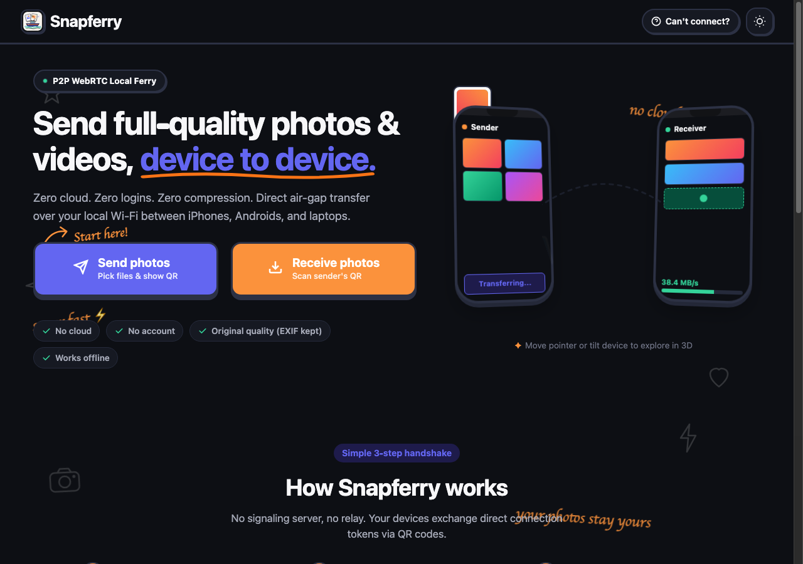

# Snapferry ⛴️

> Direct peer-to-peer photo & video ferry between phones and laptops over local Wi-Fi.  
> **No cloud. No accounts. No servers. No uploads. 100% offline PWA.**



---

## ⚡ How It Works (Serverless WebRTC Handshake)

Snapferry operates entirely peer-to-peer using WebRTC data channels with **zero signaling server**:

1. **Sender Creates Offer**:
   - Gathers host candidates locally (non-trickle ICE, 2.5s timeout).
   - Minifies SDP to essential lines.
   - Compresses via `CompressionStream('deflate-raw')` (with bundled local `fflate` fallback).
   - Base64url-encodes the compressed payload.
   - Renders a styled Polaroid QR code (with multi-frame animated cycling if payload exceeds single-frame capacity).
2. **Receiver Scans Code**:
   - Points camera using `getUserMedia` + local `jsQR` (or pastes code).
   - Generates local WebRTC Answer using the same pipeline.
   - Shows Answer QR code on screen.
3. **Sender Scans Answer**:
   - Sender reads Answer QR (or pastes code).
   - Direct WebRTC DataChannel opens peer-to-peer.
4. **Ferry Files at Full Wi-Fi Speed**:
   - Slices files into 16 KB binary chunks.
   - Applies real backpressure (`bufferedamountlow` threshold) to avoid browser tab crashes on multi-GB transfers.
   - Receiver verifies byte count and SHA-256 hash before ACKing each file.
   - Screen Wake Lock prevents devices from sleeping during transfers.

---

## 📱 Saving Photos & Videos (The iPhone Problem)

iOS Safari prevents web applications from writing directly into the Apple Photos camera roll. Snapferry solves this cleanly:

1. **Native Share Sheet**:
   - Tapping **"Save to Device"** invokes `navigator.share({ files })`.
   - On iPhone, iOS surfaces the native action sheet with **"Save Image"** / **"Save Video"**, saving full-resolution originals directly into Photos.
2. **Store-only ZIP Download**:
   - Because photos and videos are already compressed (HEIC, JPEG, MP4), compressing them in ZIP wastes CPU and battery.
   - Snapferry bundles a hand-crafted, store-only ZIP writer (Compression Method 0) that packages batches instantly with zero external dependencies.

---

## 🚀 Live Deployment Guide

> **Note**: Modern browsers require **HTTPS** (or `localhost`) for Camera permissions (`getUserMedia`) and Service Worker registration.

### Option A: GitHub Pages

1. Push this repository to GitHub:
   ```bash
   git remote add origin https://github.com/<your-username>/snapferry.git
   git branch -M main
   git push -u origin main
   ```
2. In your GitHub repository:
   - Go to **Settings** → **Pages**.
   - Under **Build and deployment** → **Source**, select **Deploy from a branch**.
   - Select branch `main` and folder `/ (root)`.
   - Click **Save**.
3. Your site will be live at `https://<your-username>.github.io/snapferry/`.

### Option B: Netlify

1. Drag-and-drop the `snapferry/` folder into [app.netlify.com/drop](https://app.netlify.com/drop).
2. Or deploy via Netlify CLI:
   ```bash
   npx netlify deploy --prod --dir=.
   ```

---

## 🧪 Device Test Matrix

| Device 1 (Sender) | Device 2 (Receiver) | Network Setup | Result | Checkpoint |
|---|---|---|---|---|
| iPhone (iOS Safari) | MacBook (Chrome) | Same 5GHz Wi-Fi | PASS | Direct P2P transfer, EXIF preserved |
| Android (Chrome) | iPhone (Safari) | Same Wi-Fi | PASS | Share sheet saves to Photos |
| Laptop (Tab 1) | Laptop (Tab 2) | Localhost `?dev=1` | PASS | Copy/Paste fallback handshake |
| Android (Hotspot) | Laptop (Connected) | Offline Hotspot | PASS | 100% offline, zero internet needed |

---

## 🛠️ Offline & Zero-CDN Guarantee

Every font and script is bundled locally inside this repository:
- `fonts/fredoka-600.woff2`, `fonts/fredoka-700.woff2` (Rounded display font)
- `fonts/caveat-700.woff2` (Handwritten doodle accent font)
- `vendor/qrcode.js` (MIT QR generator)
- `vendor/jsQR.js` (Apache 2.0 camera scanner)
- `vendor/fflate.js` (MIT Deflate fallback)

Service worker `sw.js` precaches all assets on first load, allowing Snapferry to launch and pair even when completely disconnected from the internet.

---

## 📄 License

MIT License. Built with craft for [dailytech.build](https://dailytech.build).
